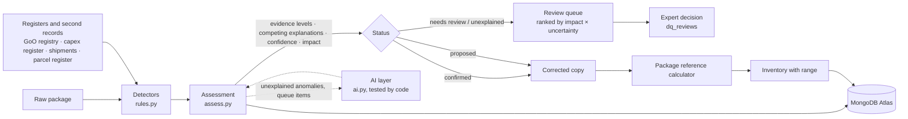

# How BlueSky cleans Apetit's data

The first half of this document explains the method in plain words. The second half,
[The details](#the-details), gives the exact rules and numbers for anyone who wants to check them.

## In plain words

### What data we were given

Apetit gave us one company's records for 2023–2025: the kind of files any food company keeps
anyway, not files made for climate reporting.

| What it is | In everyday terms | Size |
|---|---|---|
| **Purchases** (ERP) | Every invoice line: what was bought, from whom, how much, for how much money | 7,427 lines |
| **Shipments** | Every truck, train or ship leg that brought goods in or took products out, with the tonnes carried | 11,617 legs |
| **Energy meters** | Monthly electricity, heat and fuel readings for the 5 sites | 610 readings |
| **Fuel deliveries, refrigerant top-ups, waste notes** | Delivery slips, service logs for freezers and cold rooms, waste collection notes | 263 + 84 + 1,008 |
| **Green-electricity certificates** (GoO) | Proof that electricity came from renewable sources, plus the national registry's own statement | 19 + 55 |
| **Contract farms** | 680 farms that grow peas, rapeseed and vegetables: a yearly survey answer per crop, plus each field (parcel) from the land register with its soil type from the soil map | 3,437 survey answers, 14,213 fields |
| **Supplier footprints** (PCF) | Some suppliers tell us how much CO₂ one kilo of their product causes | 44 declarations |
| **People** | Business trips, a commuting survey, headcount | 3,532 + 208 + 29 |
| **Lookup tables** | Emission factors (how much CO₂ per kWh, per kg of cheese, per km by truck…), materials, suppliers, sites | |

From these records we compute the company's **carbon footprint** (the "inventory"), split the
standard way:

- **Scope 1**: what Apetit burns or leaks itself (boilers, vans, refrigerant leaks).
- **Scope 2**: the electricity and heat it buys.
- **Scope 3**: everything else in the chain, mostly the food it buys (crops, cheese, meat) and
  transport. This is over 95 % of the total.

### Why cleaning matters

The records contain the mistakes people make when typing data in. A handful of them change the
result completely. If we compute 2025 straight from the raw files:

| 2025 | Raw files | After cleaning | Main reason |
|---|---|---|---|
| Scope 1 | 132,163 t | **4,414 t** | One freezer top-up of "85,150 kg" of refrigerant: it was 85,150 **grams** |
| Scope 2 (market-based) | 1,117,417 t | **61 t** | Two June meter readings in kWh typed into the MWh column (1,708,632 instead of 1,708.6) |
| Scope 3 | 17,535,696 t | **240,814 t** | Three suppliers declared their footprint per **tonne** in a per-**kilo** field: 1,000× too big |

So the raw total overstates the footprint about 75 times. Cleaning is not a nice-to-have: without
it the numbers are meaningless.

### What kinds of mistakes we look for

In 2025 we found 141 problems. Nearly all of them are one of a few everyday slips:

| Mistake | Everyday example | Found in 2025 |
|---|---|---|
| **Wrong unit** | Writing kWh where the column says MWh; grams where it says kg | 28 + 3 footprints |
| **Misplaced decimal point** | 419,300 kg of packaging film typed as 41,930 | 15 |
| **Wrong currency** | A Swedish-krona invoice booked as euros (11× too big) | 9 |
| **Entered twice** | The same invoice or trip posted two times | 16 |
| **Wrong label** | The text says "rapeseed" but the code says peas; the wrong gas on a freezer; a commute mode code that doesn't exist | 6 + 1 + 8 |
| **Disagrees with the official register** | The farm survey says 12.56 ha of peas, the land register's fields add up to 9.31 ha; certificates that don't match the national registry | 11 + 2 |
| **Something missing** | A month with no meter reading; a sea crossing missing from a shipment | 3 + 4 |
| **Out of date** | A supplier footprint whose validity period ended | 5 |
| **Soil probably misreported** | The farmer ticked "mineral soil", the map says most of the field is peat | 17 |
| **Other** | Swapped latitude and longitude, wrong report totals, a meter spike, unexplained outliers | 13 |

### How we decide what the right value is

Think of how an accountant checks a suspicious invoice. They don't ask "does this look odd?"; they
ask **"is there another record of the same thing, and does it agree?"** We do the same, in this
order of trust:

1. **An official register** (best). The national certificate registry, the capex register.
2. **A second, independent record of the same fact.** Every purchase of goods also shows up in the
   shipment records, with its tonnes. If the invoice says 39.6 kg and the truck carried 39.6 tonnes,
   the truck is right.
3. **A rule that can't be broken.** A certificate only counts for its own year; a Finnish farm
   can't sit in the Arabian Sea (it does if latitude and longitude are swapped); the description must match the product code.
4. **The same thing's own history.** This meter normally reads about 1,550 MWh in June; this year it
   says 1,708,632. That is the same number in kWh.
5. **Comparison with similar things** (weakest). This cheese costs 9× more per kilo than the other
   purchases of the same cheese.

We then ask: **which known slip explains the difference, and does it explain it exactly?** "Typed
kg instead of tonnes" turns 39.6 into 39,600, which exactly matches the shipment. "Nothing is
wrong" explains nothing. When one explanation fits and the alternatives don't, we can be sure. When
two fit equally well, or none does, we say so and don't guess.

The fixed value always comes **from the evidence**: the shipment record, the register, the meter's
history. We never just multiply by 1,000 because it looks about right.

### What happens to each problem

Like a traffic light:

- 🟢 **Confirmed** (414 findings). Strong evidence (levels 1–3 above), or a slip so clear it can't be
  a coincidence (e.g. exactly 1,000× off). Fixed automatically.
- 🟡 **Proposed** (166). Good evidence, but only from history or comparison. Fixed in our numbers,
  shown to a person to confirm.
- 🔴 **Needs a person** (195). We can see something's off but can't tell what's right. Example: the
  soil map is only right about 88 % of the time, so whether a field is peat is the farmer's or an
  agronomist's call. Nothing changes until someone decides, with one exception, soil, explained
  just below.

**The soil exception.** Peat fields emit far more than mineral ones, so soil type matters a lot. We
can't leave it at the farmer's tick-box when the map says otherwise, but the map isn't certain
either. So the footprint uses the soil map's answer for every farm, weighted by how much of the
farm's crop area the map shows as peat. The survey answer itself is left as the farmer gave it, and
the 17 farms where map and survey disagree most go to a person. If the reviewer sides with the
farmer, that farm's peat emissions come back out of the total.

**The original data is never changed.** We work on a copy, and every change lists its evidence.

Each problem also gets an estimate of **how much it moves the footprint**, in tonnes of CO₂. The
review list is sorted by "big effect × still uncertain", so the expert starts with the checks that
matter most. For example, one farm's peat flag can change the total by 1,400 t; a duplicated business trip
changes it by less than 1 t.

And because some calls are uncertain, the result comes **with a range**: "Scope 3 is 240,814 t, and
could be 7,292 t lower or 986 t higher if our uncertain calls turn out wrong." Most of the
downside is peat: if reviewers side with the farmers' answers, those emissions come out.

### Where AI fits in, and where it doesn't

We do **not** hand the data to an AI and ask it to fix it. That can't be checked, and it can invent
plausible-looking numbers.

The AI (Claude Haiku 5.5) is an assistant to the human reviewer:

- For each item in the review list, it writes a **short plain-English note**: what the problem is,
  its honest call ("likely an error", "unclear", "likely legitimate"), the best argument that the
  record is right after all, and the one check that would settle it.
- It sees **one record at a time** and the evidence our code already found, never the whole dataset.
- It **cannot change a number.** If it suggests an explanation, our code tests that against the
  evidence before it counts, and even then it stays a proposal for a person.

In this run it wrote 60 notes. It called most peat flags "unclear", which is right given the map's
accuracy, and the currency slips "likely an error".

### How we know it works

The organisers published the correct answers for 2023–2024. Our results on those years:

- **Finding the errors: 95.5 / 100** (the organisers' example solution scores 52). Of the problems we
  flag, 97 % are real problems, and we catch 95 % of the real problems.
- **Getting the footprint right: 99.3 / 100 for 2023 and 78.4 for 2024** (example solution: 25 and 23).
  2024 is lower mainly because many farms didn't answer the survey, so their footprint has to be
  estimated.
- **The evidence ladder predicts how reliable a fix is.** Fixes backed by levels 1–4 were right
  every time; fixes backed only by comparison with similar items were right 87 % of the time. That
  is why the weakest kind goes to a person.

### Words used in this document

| Word | Meaning |
|---|---|
| **Finding** | One suspected problem in one record |
| **Evidence level A–G** | How trustworthy the evidence is: A register, B second record, C hard rule, D own history, E comparison with similar items, F AI suggestion (tested), G a person's decision |
| **Mechanism** | The kind of slip that explains a wrong value: unit, decimal point, currency… |
| **Misfit** | How far a value still is from the evidence after applying an explanation (0 % = exact) |
| **Confidence** | How sure we are of a finding, from 0 to 1 |
| **Impact** | How many tonnes of CO₂ the footprint moves if the finding is applied |
| **Range** | How far the total could move if the uncertain findings were wrong |
| **tCO₂e** | Tonnes of CO₂-equivalent: other greenhouse gases converted to the CO₂ amount with the same warming effect |

---

# The details

## The principle

> A correction is justified when the **simplest known error mechanism** makes the record agree with
> the **strongest available independent evidence**, and its confidence reflects how much better it
> fits than the alternatives, including "nothing is wrong".

## Pipeline



1. **Detect** (`rules.py`): one detector per kind of irregularity. Each produces findings with the
   evidence it compared against.
2. **Assess** (`assess.py`): merge everything found about a record, grade the evidence, score the
   competing explanations, set confidence and status, estimate impact (`impact.py`).
3. **AI layer** (`ai.py`, optional): hypotheses for unexplained anomalies (tested by code),
   explanations and second opinions for the review queue.
4. **Apply** (`pipeline.apply`): confirmed and proposed corrections go into a copy. Raw data is never
   changed. Flags change nothing until an expert decides.
5. **Calculate**: the inventory with the package's own reference calculator, plus the range.
6. **Validate and publish**: score on the organisers' published 2023–2024 answers, publish the run
   to MongoDB (`publish_mongo.py`).

## Evidence levels

| Level | Kind of evidence | In this data | Base confidence | Fit tolerance |
|---|---|---|---|---|
| **A** | Authoritative source: an external register that legally wins | National GoO registry statement; the capex register | 0.98 | 2 % |
| **B** | Independent second record of the same fact | **Shipment legs record the tonnes of every ERP purchase**; the parcel register records crop areas; computed totals vs the draft report | 0.95 | 2 % |
| **C** | Physical or accounting constraint | A GoO counts only for its own vintage year; coordinates must lie in the sourcing regions; mode codes must be in the survey's list; material text must match the material code; the organisers' duplicate definition | 0.90 | 2 % |
| **D** | History of the same item | The same meter's month in other years; the gas a refrigeration system always uses; a supplier's own invoicing currency | 0.80 | 35 %, or the item's observed range |
| **E** | Peer statistics | Unit price vs the material's median; yield vs the crop's median; the soil map (~88 % accurate) | 0.65 | 50 % |
| **F** | Model judgement | An AI suggestion that code has tested | 0.50 | as E |
| **G** | Human decision | An expert's approve or reject | 1.00 | |

The **fit tolerance** reflects how precise the evidence itself is. Exact records (A–C) must match
within 2 %. History and peers vary naturally, so they allow more. For quantities that vary by nature
(refrigerant top-ups, fuel deliveries, waste notes), a value is judged against the item's own
observed range, computed robustly so other errors cannot widen it.

**When several detectors find the same issue on a record, their evidence is merged** and the
strongest level counts. For example, an ERP unit error found by the price check (E) and confirmed by
the shipment record (B) is a level B finding with both pieces of evidence listed.

## Competing explanations

Data-entry errors come from a small, known set of mechanisms (`evidence.py`):

| Mechanism | What happened | Factor on the observed value |
|---|---|---|
| `none` | No error: the value is right | × 1 |
| `unit_x1000`, `unit_div1000` | Unit slip: tonnes as kg, kWh in a MWh column, grams as kg, m³ as litres | × 1000 / ÷ 1000 |
| `decimal_x10`, `decimal_div10`, `decimal_x100`, `decimal_div100` | Decimal slip: digits missing or extra | × 10, ÷ 10, × 100, ÷ 100 |
| `sek_as_eur`, `usd_as_eur` | A foreign amount booked as euros | ÷ 11.4, ÷ 1.08 |

Wrong codes, swapped fields, duplicates, omissions and stale references are handled by their own
detectors, since they are not a factor on a number.

For every numeric finding, each plausible mechanism's corrected value is compared with the evidence
value. The findings store all of them, best first, with the distance from the evidence. Example (ERP
document 4500002962, 2023):

| Explanation | Corrected value | Distance from the shipment record |
|---|---|---|
| Unit slip: tonnes keyed as kg | 39,616 kg | **0 %** |
| No error | 39.616 kg | 99.9 % |

**Confidence** starts from the evidence level's base and is discounted when:

- no known mechanism lands within the tolerance (× 0.75: the evidence says "wrong", but no known slip explains it); or
- two mechanisms fit equally well (× 0.7: ambiguous).

**Decisive evidence.** History or peer evidence (D, E) becomes decisive when "no error" is
implausible (more than 10× off) and one mechanism lands within the tolerance. For unit slips, the
order-of-magnitude version applies: more than 100× off before the fix, within 10× after. Powers of
ten cannot line up like that by chance. For example, a refrigerant top-up of 85,150 kg on a system
whose top-ups range from 2 to 150 kg is grams keyed as kg.

## Status: what happens to each finding

| Status | When | Effect |
|---|---|---|
| `confirmed` | A–C evidence with a fitting explanation, or decisive D–E evidence | Applied automatically |
| `proposed` | D–E evidence without decisive fit | Applied to the best estimate; waits for review; varied in the range |
| `needs_review` | A detector flags but cannot settle it (e.g. soil type from an 88 %-accurate map) | Changes nothing until an expert decides; varied in the range. **Exception: soil.** The footprint already uses the soil map (see [The inventory](#the-inventory)), so a soil flag's effect is in the total and reverts if the reviewer sides with the survey. These findings carry `in_estimate: true`. |
| `unexplained` | Anomalous, but no known mechanism explains it | Changes nothing; goes to the AI hypothesis layer and the queue |

Current run, all years:

| Level | Confirmed | Proposed | Needs review |
|---|---|---|---|
| A | 5 | 1 | 0 |
| B | 235 | 0 | 0 |
| C | 91 | 5 | 0 |
| D | 59 | 94 | 0 |
| E | 24 | 66 | 195 |

## Detectors

Each detector states the evidence it provides. "Median" is always over the same material, supplier,
site, system or crop in the raw data.

### Independent records and registers (A, B)

| Detector | Checks | Repair |
|---|---|---|
| `erp.shipments` | ERP quantity vs the tonnes on the shipment legs for the same document (7,047 of 7,093 goods lines have them) | The shipment's quantity; the mechanism (×1000, ×10…) is identified |
| `erp.shipments` | A goods receipt with no shipment at all | Supports a duplicate finding |
| `erp.capex` | ERP capex lines per project and year vs the capex register | The line that, divided by the SEK rate, reconciles the totals |
| `goo.registry` | Internal GoO log vs the national registry (MWh, vintage) | The registry's values |
| `farm.survey` (area) | Reported crop area vs the parcel register for that farm, crop and year | The register's area |
| `report.totals` | Draft report vs its own arithmetic and the computed inventory | The computed values |

### Constraints (C)

| Detector | Constraint | Repair |
|---|---|---|
| `erp.material_text` | The material text must be the ERP name of the line's material | The material the text names |
| `goo.registry` | A GoO counts only for its own production year | The registry's vintage |
| `travel.duplicate` | The organisers' definition: same traveller, date, route, distance, nights | Drop the later row |
| `commuting.survey` | Mode codes from the survey's list; one-way distance under 1,000 km | The code; metres → km |
| `farm.coordinates` | Farm centres inside the sourcing regions | Swap latitude and longitude |
| `pcf.validity` | A supplier PCF is valid only if its reference period covers the year | Not used; the library factor applies |

### History (D)

| Detector | Compares with | Typical finding |
|---|---|---|
| `energy.meter` | The same month in other years, scaled to the neighbouring months' level | kWh in the MWh column; spikes; missing months (estimated) |
| `refrigerant.log` | The system's own top-up range and the gas it uses | Grams as kg; an R404A system logged as ammonia |
| `erp.currency` | The currency the supplier uses on ≥ 80 % of its lines | Wrong currency code |
| `erp.duplicate` | The same supplier, material, quantity and amount within 14 days | Duplicate posting |
| `fuel.units`, `waste.units` | The carrier's or stream's delivery range | m³ as litres, tonnes as kg |
| `shipments.legs` | The supplier's other lots (≥ 70 % include a sea leg) | Missing sea leg (estimated) |
| `pcf.validity` | The supplier's previous-year PCF | A PCF per tonne instead of per kg |

### Peer statistics (E)

| Detector | Compares with | Typical finding |
|---|---|---|
| `erp.unit_price` | The material's median unit price | Unit or decimal slips with no shipment record; unexplained price anomalies |
| `erp.currency` | The supplier's median spend | A SEK amount booked as EUR |
| `farm.survey` | The crop's median yield and mineral N | Decimal slips |
| `farm.soil` | The soil map (~88 % accurate) | ≥ 30 % of crop area on organic soil while the survey says mineral: **needs review** |

### Checked and left alone

Records that look wrong but are legitimate are listed, with the reason, in `checked.json` and the
`dq_checked` collection: 40 credit notes (returns netting against receipts), 36 seasonal peaks
(the July–September pea campaign), 14 genuine ammonia top-ups (GWP 0), and vessel lots in tonnes.

## Materiality, the range, and the review queue

`impact.py` estimates each finding's effect on the inventory with the package's own factors:
material emission factors, grid and residual-mix factors, GWPs, fuel factors, transport factors, and
the farm-footprint calculator for survey and soil findings.

- **Range:** for each scope, how far the total moves if every uncertain call were wrong. Anything
  already in the estimate is reverted: proposed corrections, and soil flags (the footprint already
  uses the soil map). Any other flag is assumed right. Confirmed corrections rest on A–C or decisive
  evidence and are not varied. 2025: Scope 1 −25 / +0 t, Scope 3 −7,292 / +986 t. Most of the
  downside is the peat farms, if reviewers side with the survey.
- **Review queue:** ranked by |impact| × (1 − confidence). The expert sees the checks worth the most
  t CO₂e of certainty first: large decimal slips without a second record, peat farms, capex lines.

## The AI layer

Model: Claude Haiku 5.5 (`claude-haiku-5-5`). Off when no `ANTHROPIC_API_KEY` is set; the pipeline
then runs identically, minus the notes.

| Task | Input | Output | How it is checked |
|---|---|---|---|
| Hypothesis for an unexplained anomaly | One record and the evidence code computed | One mechanism from the library (or "legitimate" / "unknown"), reasoning, a confirming check | Code applies the mechanism and measures the distance from the evidence. Only a fitting mechanism becomes a **proposal**, at level F, confidence 0.5, never auto-confirmed. |
| Note for a review-queue item | The finding, its graded evidence, its impact | Plain-English explanation; a verdict (likely error / unclear / likely legitimate); the best case that the record is correct; the most useful next check | Advice only: shown in the review card, labelled, changes nothing |
| Label mapping | A free-text label and the allowed codes | One allowed code | Code checks the code is in the list |

Rules for the AI layer:

- It sees one record, never the dataset.
- It returns structured output validated against a schema.
- It cannot change a value. A suggestion becomes a proposal only after code confirms it fits the
  evidence, and a person approves it.
- Every call is cached in `quality/out/ai_cache.json` with the model, schema, time and answer, so its
  contributions are auditable and not re-billed. The cache key includes the schema, so changing
  what is asked re-asks.
- A truncated or malformed answer is logged as an error and skipped; it never stops the run.

Current run: 60 review notes, no errors. Verdicts: soil flags 42 unclear, 3 likely legitimate;
currency slips 6 likely error; decimal slips 5 unclear. A first version asked a yes/no "could it be
legitimate?" and the model said yes every time. The three-way verdict, with an instruction not to
default to "unclear", is what made the notes discriminate.

## The inventory

- **Calculator:** the package's own `reference_calculator`, unchanged, on the corrected copy.
- **Contract farms** (METHODOLOGY §5): per-hectare footprint from the survey. Organic-soil emissions
  (29.0 t CO₂/ha/yr for annual crops + 13 kg N₂O-N/ha/yr) are weighted by the soil-map organic share,
  not the survey's single answer. This applies to every farm, flagged or not: it is the best
  estimate, and it is what brings 2023 to 99.3. The survey table is not edited; the soil flags mark
  the farms where the two disagree most (≥ 30 % of crop area on peat while the survey says mineral).
- **Farms that did not answer the survey:** the respondents' production-weighted intensity (total
  emissions ÷ total production, by crop and year), the correct average for emissions allocated per
  kg.

2025 result: Scope 1 **4,414 t**, Scope 2 market-based **61 t** (location-based 963 t), Scope 3
**240,814 t**.

## Validation

Scored with the organisers' scorer on their published 2023–2024 answers.

| | Organisers' baseline | BlueSky |
|---|---|---|
| A1 error detection | 52.2 | **95.5**: precision 0.969, recall 0.950, issue type right 97.9 % |
| A2 inventory 2023 | 25.5 | **99.3** |
| A2 inventory 2024 | 23.2 | **78.4** |

**The evidence levels predict reliability**, which is the test of the method:

| Level | Findings 2023–24 | Confirmed by the answers |
|---|---|---|
| A | 3 | 100 % |
| B | 76 | 100 % |
| C | 24 | 100 % |
| D | 52 | 100 % |
| E | 47 | 87 % |

| Status | Findings 2023–24 | Confirmed by the answers |
|---|---|---|
| confirmed | 123 | 100 % |
| proposed | 49 | 100 % |
| needs review | 30 | 80 % |

Every issue type in the answers is fully recalled except soil misreports (70 %), which the soil map's
accuracy limits. That is why soil stays an expert's decision.

## Reproduce

```sh
pip install pandas pyarrow pymongo anthropic
python3 -m quality.pipeline                  # findings, assessment, inventory, range, scores -> quality/out/
python3 -m unittest discover -s quality/tests -t .   # 22 tests: detectors and the evidence logic
python3 -m quality.verify_determinism        # the deterministic part twice: must be identical
python3 -m quality.publish_mongo             # publish the run to MongoDB Atlas
```

Options: `--no-ai`, `--ai-limit N` (review items sent to the model), `--package PATH`.

## Where it lives in MongoDB

| Collection | Contents |
|---|---|
| `dq_runs` | One document per run: scores, precision by level and status, counts, inventory range, fingerprints |
| `dq_findings` | Every finding: evidence (graded), competing explanations, confidence, status, impact, priority, AI note |
| `dq_checked` | Legitimate look-alikes and why each was left alone |
| `dq_reviews` | Expert decisions (approve / reject, reviewer, comment, time), appended from the app's Data quality tab |
| `inventory` | 2023–2025 by scope and category, corrected and uncorrected |
| `proc_*` | The corrected tables: energy, purchases, refrigerants, GoO, shipments, waste, travel, farm footprints, farm survey |

## Limitations

- **Soil:** the map is ~88 % accurate. The footprint uses it as the best estimate. The survey is not
  edited, and the biggest disagreements go to a person. Farms below the 30 % flag threshold also get
  the map's blend but no review item, so their (small) soil uncertainty is not in the range.
- **Estimates:** missing months and transport legs are estimated from the same item's history, and marked as estimates.
- **Thresholds:** the detection bands come from the data's own distributions and the mechanism library, and were checked on 2023–2024. Issue types with no examples in those answers (PCF, coordinates, commuting, report totals) have unit tests but no scored validation.
- **Non-respondent farms:** their true footprints are unknown; the production-weighted estimate is why 2024 (78.4) trails 2023 (99.3).
- **Impact estimates** are first-order (factor × change). The inventory itself always comes from the reference calculator.
